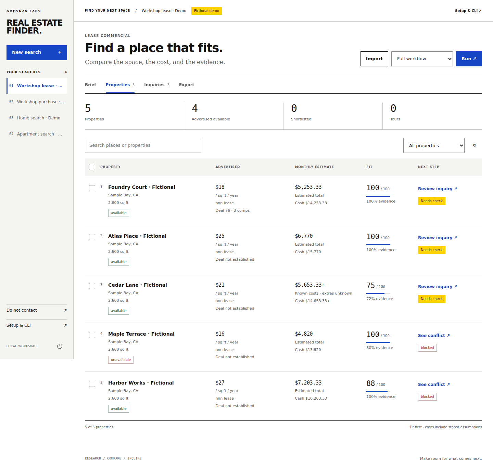

# Real Estate Finder

**Turn a property objective into a ranked shortlist, a usable cost comparison, and researched inquiries you can review.**



A local app for renters, home buyers, and business owners looking to lease or buy commercial space. It uses your installed **Codex or Claude Code CLI** for bounded research, with a separate provider and model for each task. The browser and command line share one durable workspace.

## Start

```sh
git clone https://github.com/goosnav/real-estate-finder.git
cd real-estate-finder
uv sync --project app --locked
uv run --project app python app/run.py gui
```

Choose **Demo** to run the complete workflow with fictional properties and no provider account. For live research, install and sign in to [Codex](https://developers.openai.com/codex/cli/) or [Claude Code](https://code.claude.com/docs/en/overview), then create a search. `doctor` checks installed capabilities without making a model call. Provider authentication stays with those CLIs.

The native ZIP builder and launchers are also included. They bootstrap pinned Python and dependencies and open the browser. These are **unsigned development builds**; the complete native acceptance matrix is still outstanding. See [Install and launch](docs/INSTALL.md).

## Four workflows

| Mode | Useful inputs | What the comparison emphasizes |
|---|---|---|
| `residential_rent` | Location, monthly budget, size, bedrooms, pets or accessibility needs, move date | Monthly rent and known fees, deposits, move-in cash, concessions, lease conditions |
| `residential_buy` | Location, price ceiling, monthly budget, cash available, property requirements | Purchase price, financing scenario, taxes, insurance, HOA, maintenance and upfront costs |
| `commercial_lease` | Intended use, area, location, monthly budget, required access/equipment | Normalized rent, NNN/CAM or operating charges, fit-out cash, lease term and permitted-use questions |
| `commercial_buy` | Business use, area, purchase budget, financing and cash assumptions | Acquisition and ownership costs, space fit, zoning/use and diligence gaps |

Write the objective in plain language. Add a needs brief or supporting PDF, DOCX, TXT, or Markdown documents if useful. You can provide public listing, owner, broker, or other research URLs as starting points, or import a CSV/XLSX list you already have.

The workflow is **Brief → Discover → Research → Verify → Draft**. Search runs use several bounded discovery calls, individual property research, independent source checks, then one short three-message sequence per eligible property. The app preserves completed work, so pause and resume do not throw away the list.

## What you get

- A ranked property list with address/unit, listing link, contact details, asking price and its exact basis, size, bedrooms/bathrooms where relevant, availability and dates.
- Separate **fit**, **evidence confidence**, and **deal comparison**. A good fit is not automatically a bargain. Missing comparable evidence leaves the deal assessment unknown.
- Cost calculations with known amounts, user assumptions, and missing inputs shown separately. An incomplete estimate is never presented as a complete all-in cost.
- Source URLs and dated evidence behind property claims. A reachable page alone does not establish availability.
- Property-specific risks and diligence questions: missing fees, suitability, condition, lease terms, ownership/use information and other unresolved facts.
- A short inquiry and two follow-up drafts, each with source-backed context. You review and can edit them before exporting.
- A local tracker for shortlist, contact, reply, tour, application, offer, negotiation, and closed outcomes.
- CSV and XLSX research exports, plus a source-checked tour list, a guarded outreach export, and global email/domain exclusions.

The app does not send inquiries, call brokers, book tours, submit rental applications, place offers, or make payments. Opening a listing or exporting a draft leaves the decision with you.

## Cost comparisons that keep their assumptions

### Renting and commercial leasing

The calculator distinguishes total/month/year and dollars-per-square-foot-per-month/year. Commercial rent such as `$24/sqft/year` becomes a monthly base figure only when the area is known. A price with an unknown basis stays unresolved.

Listed recurring charges are tracked separately from deposits and one-time fees. Deposits are part of initial cash needed, not recurring monthly expense. A concession can produce an effective rent estimate when both its total and the lease length are known; the regular payable rent remains visible. Unknown NNN/CAM expenses are unresolved costs, not zeros.

### Buying

The financing scenario supports cash or mortgage purchases, down-payment percentage, a user-supplied interest rate, loan term, closing-cost assumption, and recurring/upfront costs. A mortgage estimate uses principal and interest and the available tax, insurance, HOA, maintenance, utilities and mortgage-insurance inputs. Empty fields remain missing inputs; the app does not fetch or invent a lender rate.

Explicit scenario values override matching listed charges; leaving an assumption blank uses a listed value when one exists. The inputs are planning assumptions. They do not constitute a loan quote, appraisal, tax assessment, insurance quote, zoning determination, or legal review. Commercial financing may involve terms, balloon payments, guarantees, or fees that the simple amortizing scenario does not model. Obtain property-specific terms before making a commitment.

### Deal assessment

Comparable records retain source, date, transaction mode, area, price basis, and whether the figure is **asking** or **closed**. The app requires at least three compatible independently checked asking-price records observed within 45 days for its normalized comparison. It does not treat a few asking prices as an appraisal or combine incompatible rent bases, currencies, or property modes.

## Research and ranking

Discovery can explore public owner/property-manager listings, brokers, accessible property portals, public records and planning pages, and dated local market or development news. News can suggest where to look or what to ask; it is not a confirmed available property or proof of a discount. No MLS license, private listing feed, portal account, or paid data subscription is bundled. Site access and provider search coverage affect the results. [Source behavior and limitations](docs/SOURCES.md) explains the boundary.

Fit weights are configurable. The default split is property suitability **25**, location **20**, budget **25**, required features **25**, and timing **5**. Required conflicts and missing information remain visible alongside the score. Ranking uses the user's property criteria and evidence; prompts exclude protected personal traits and demographic neighborhood steering.

The software retains uncertainty. It cannot determine that a property is safe, legally usable, correctly priced, insurable, or structurally sound from an advertisement. Commercial intended use needs independent confirmation; a broker description or zoning label alone is not a permit.

## Choose the agent for each task

| Route | Work | Web access |
|---|---|---|
| `profile` | Turn your objective and supporting material into a search brief | Disabled |
| `discovery` | Find public property candidates and sources in bounded batches | Enabled |
| `research` | Research one property, its costs, fit, risks and comparable evidence | Enabled |
| `outreach` | Draft a three-message inquiry from saved evidence | Disabled |

Each route accepts `provider: inherit|codex|claude` and a model name. A blank model uses the global model when that provider matches the global provider; otherwise it uses the selected CLI's default. Model names are passed through rather than frozen into an obsolete dropdown.

```json
{
  "settings": {
    "provider": "codex",
    "model": "",
    "routes": {
      "profile": {"provider": "inherit", "model": ""},
      "discovery": {"provider": "codex", "model": ""},
      "research": {"provider": "claude", "model": ""},
      "outreach": {"provider": "claude", "model": ""}
    }
  }
}
```

Set target count, query count, minimum fit, total calls, run time, per-call timeout, research-page limit, and concurrency. Claude also has turn and dollar allowances. The app reserves a conservative allowance before each Claude call; an interrupted call with no reported cost keeps that allowance. Codex has no equivalent enforceable dollar cap in this adapter, so call/time limits apply and missing cost reports are shown as unpriced. A target of 100 is a discovery ceiling, not a promise of 100 suitable properties.

## CLI

Commands run through `uv run --project app python app/run.py`. Use `--data-dir PATH` before the subcommand for a separate workspace, and each command's `--json` flag for machine-readable output.

```sh
# Check local tools. This does not invoke a model.
uv run --project app python app/run.py doctor --json

# Create a commercial lease search; copy the returned search ID.
uv run --project app python app/run.py search create \
  --name "Workshop space" --mode commercial_lease \
  --objective "Find a small workshop with loading access and a workable total cost." \
  --location "Dayton, OH" --property-type industrial \
  --min-area 1500 --max-area 4000 --monthly-budget 4500 \
  --intended-use "Light fabrication and storage" \
  --provider codex --research-provider claude \
  --target 30 --max-calls 70 --minutes 60 --json

# Live research. Replace SEARCH_ID with the actual ID.
uv run --project app python app/run.py run SEARCH_ID

# Inspect properties and export the complete research table.
uv run --project app python app/run.py properties SEARCH_ID --json
uv run --project app python app/run.py export SEARCH_ID \
  --format xlsx --scope all --output exports/properties.xlsx

# Run a fictional buying scenario without model or web calls.
uv run --project app python app/run.py demo --mode residential_buy --run --json
```

Buying searches also accept `--financing cash|mortgage`, `--down-payment`, `--interest-rate`, `--loan-years`, `--closing-cost-percent`, `--price-max`, and `--cash-available`. For all advanced fields, use `search create --config examples/search-settings.json` or `search configure SEARCH_ID --file settings.json`. `schema search --json` and `schema property --json` expose the exact contracts.

| Command | Purpose |
|---|---|
| `gui` | Open the local browser app |
| `search create/list/show/configure` | Create and inspect searches; update nested settings |
| `brief-upload ID --file FILE` | Add needs/supporting documents; `--text` replaces pasted brief |
| `import-properties ID FILE` | Import property CSV/XLSX |
| `run ID --stage profile|discover|research|verify|draft` | Run one stage, or omit for the pipeline |
| `runs list/show`, `pause`, `resume`, `cancel` | Inspect and control durable work |
| `properties ID` | Ranked list, optionally filtered by status/mode/minimum fit |
| `edit-property ID --file patch.json` | Correct contact/property information or edit drafts |
| `review ID --status approved` | Record human review; never sends anything |
| `activity ID --status tour_scheduled` | Track next steps; optional follow-up date/note |
| `export ID --format csv|xlsx --scope all|shortlist|outreach|tour` | Download research or reviewed inquiry-ready rows |
| `verify-import ID FILE` | Import dated independent email-verifier results |
| `outcomes-import ID FILE` | Import contact/property tracking using IDs or listing URLs |
| `suppress add/list/import` | Maintain global email/domain exclusions |
| `backup --output FILE` | Create a consistent SQLite backup |

`Ctrl-C` pauses an active CLI run. Exits: **0** success, **2** input/operation error, **3** failed run, **4** budget exhausted, **5** paused/cancelled. JSON output stays on stdout; non-JSON progress is for terminals. Examples are fictional and live imports start unverified.

## Storage and privacy

SQLite data lives in your OS's `RealEstateFinder` application-data directory, separate from Job Finder and Auto Outbound. `--data-dir` or `REAL_ESTATE_FINDER_DATA` selects another workspace. The app has no telemetry or hosted account. Uploaded originals are extracted in memory; stored text and generated research may contain private information. Live agent tasks send the necessary inputs to the selected provider. Local storage does not mean offline AI processing. See [Security and data boundaries](docs/SECURITY.md).

## Development and verification

```sh
uv sync --project app --locked
uv run --project app ruff check --config app/pyproject.toml app/src tests
uv run --project app python -m pytest -c app/pyproject.toml tests
python scripts/launcher/test_packaging.py
# With the Go version pinned in scripts/launcher/tool-versions.json:
(cd scripts/launcher/supervisor && go test ./...)
```

The source test workflow runs on Linux, macOS, and Windows. Unit and integration tests cover the actual cost calculations, ranking/readiness rules, imports/exports, provider adapters, API/CLI parity, cancellation, caching, and constrained network behavior. Browser evidence is recorded in [GUI QA](docs/GUI_QA.md), and native build/integration evidence in [Native QA](docs/NATIVE_QA.md). CI is source validation; it does not establish native desktop acceptance.

A live paid-agent property search, real market coverage, contact deliverability, and all six clean native target environments are not established by the deterministic suite or fictional demo. These limits are recorded explicitly instead of represented as a verified market benchmark.

Further documentation: [Architecture](docs/ARCHITECTURE.md) · [Local API](docs/API.md) · [Sources](docs/SOURCES.md) · [Install](docs/INSTALL.md) · [Security](docs/SECURITY.md).
